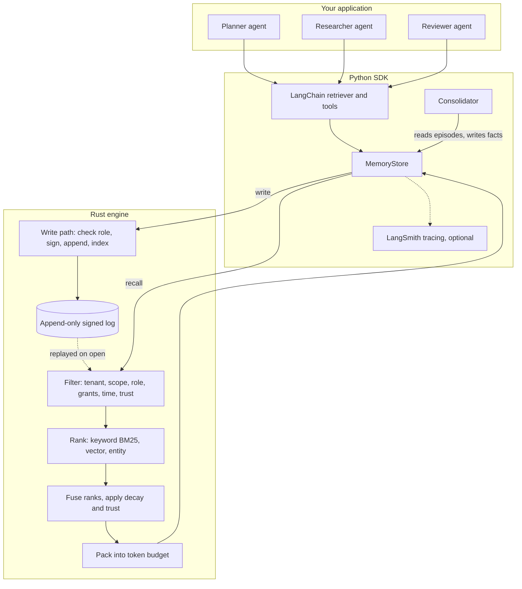
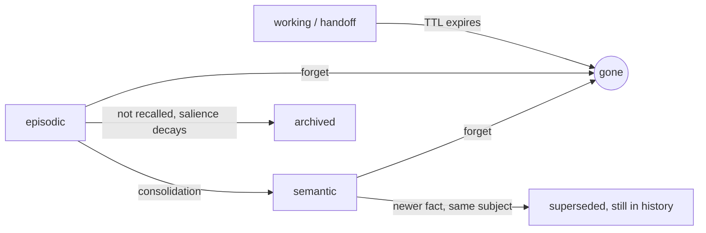
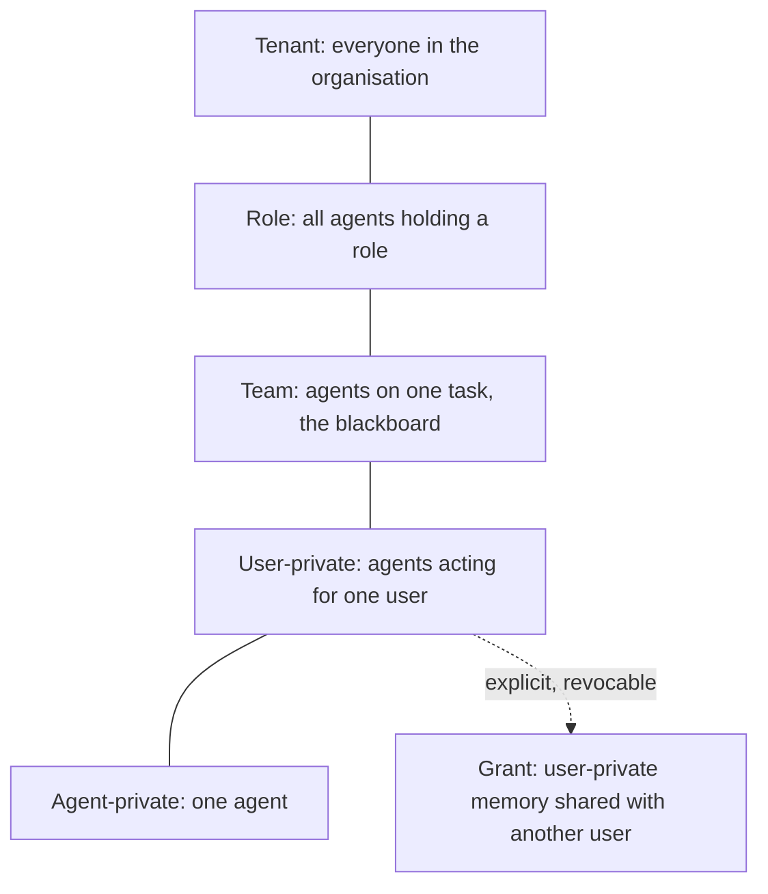
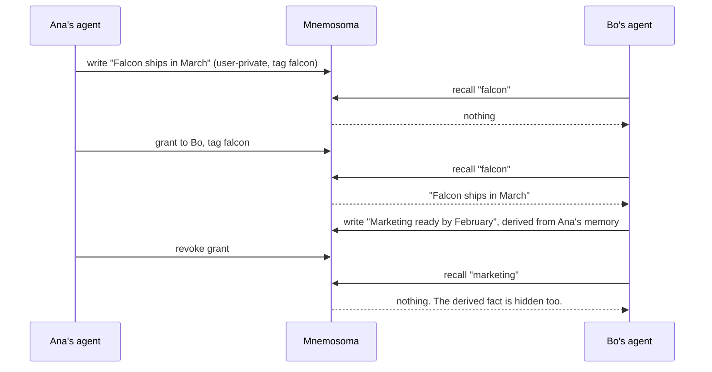
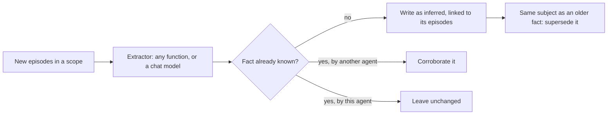

# Mnemosoma

**Shared memory for teams of AI agents and the people they work for.** It knows when a fact was true, who said it, who may see it, and when to let it go.


Mnemosoma is a memory engine for systems where many agents, in different roles, serve many users. The engine is written in Rust. You use it from Python, on its own or through LangChain and LangGraph. It runs on a laptop with no services, no API keys and no paid dependencies.

```python
from datetime import datetime, timezone
from mnemosoma import Identity, MemoryStore, Scope

store = MemoryStore(signing_key="change-me", path="memory.log")

ana = Identity(tenant="acme", user="ana", agent="researcher-1", role="researcher", team="launch")
bo  = Identity(tenant="acme", user="bo",  agent="researcher-2", role="researcher", team="launch")
january, june, september = (datetime(2026, m, 1, tzinfo=timezone.utc) for m in (1, 6, 9))

# Ana's agent remembers something she said. It lives in Ana's private scope.
store.write(ana, "Ana works at Initech", scope=Scope.user("ana"),
            subject="ana/employer", assertion="told_by_user", valid_from=january)

store.recall(ana, "where does ana work")   # -> "Ana works at Initech"
store.recall(bo,  "where does ana work")   # -> []  Bo's agent cannot see it.

# The fact changes. The old version is kept, not overwritten.
store.write(ana, "Ana works at Hooli", scope=Scope.user("ana"),
            subject="ana/employer", valid_from=september)

store.recall(ana, "where does ana work")               # -> "Ana works at Hooli"
store.recall(ana, "where does ana work", as_of=june)   # -> "Ana works at Initech"
```

## Contents

- [What it is for](#what-it-is-for)
- [The problems it solves](#the-problems-it-solves)
- [Architecture](#architecture)
- [Memory model](#memory-model)
- [Agents, roles and users](#agents-roles-and-users)
- [Sharing between users](#sharing-between-users)
- [Facts that change over time](#facts-that-change-over-time)
- [Trust and provenance](#trust-and-provenance)
- [Consolidation](#consolidation)
- [LangChain, LangGraph and LangSmith](#langchain-langgraph-and-langsmith)
- [Capacity](#capacity)
- [What is built and what is not](#what-is-built-and-what-is-not)
- [Install and develop](#install-and-develop)
- [Where this stands](#where-this-stands)

## What it is for

Most agent memory is built for one agent talking to one user. Products are no longer shaped like that. A support desk runs a triage agent, a billing agent and an escalation agent across thousands of customers. An internal assistant serves every employee and has to keep each person's context apart. A research pipeline passes work from a planner to several workers to a reviewer.

In those systems the hard questions are about who and when, more than about search:

| Situation | What has to be true |
|---|---|
| Two customers use the same assistant | Nothing one says can ever surface for the other |
| A planner hands a task to a worker | The worker starts from the handoff, not from a transcript |
| An agent guesses, and another agent reads the guess | The second agent can tell it was a guess |
| A user's address changes | New answers use the new address; "where did we ship in March?" still works |
| A web page tells the agent to remember something false | It does not become a trusted fact |
| A user asks to be forgotten | Their data and everything computed from it is gone from disk |

Mnemosoma treats those as the core of the engine.

## The problems it solves

Each row is a failure reported in 2026 research and production write-ups ([sources](#sources)). Every row marked Built has a test that names it.

| # | Problem | What goes wrong | How Mnemosoma handles it | Status |
|---|---|---|---|---|
| 1 | Cross-user leakage | Similarity search has no idea of permissions | Permission filter runs inside the engine, before ranking | Built |
| 2 | Role blindness | Every agent sees everything, or nothing is shared | Per-role read and write policies over six scopes | Built |
| 3 | Stale facts | Old facts are reused with full confidence | Bi-temporal facts; a new fact closes the old one | Built |
| 4 | Lost history | Updating a fact destroys what used to be true | Supersession chains and point-in-time recall | Built |
| 5 | Concurrent writers | Agents overwrite each other | One ordered chain per subject; both authors kept | Built |
| 6 | Guesses become facts | One agent's inference is another agent's ground truth | Inferences stay marked until corroborated or approved | Built |
| 7 | Memory poisoning | Injected content persists across sessions ([OWASP ASI06](#sources)) | Trust tiers, signed writes, taint that follows derived facts | Built |
| 8 | Unbounded growth | Memory grows until retrieval degrades | Salience decay, TTLs and archival | Built |
| 9 | Context rot | More retrieved text lowers answer quality | Recall packs results into a token budget | Built |
| 10 | Erasure | Deleting a record leaves copies and derived facts | Cascading delete that rewrites the log | Built |
| 11 | Brittle consolidation | Episodes become facts through ad-hoc rules | A separate pass with pluggable extractors | Built, basic |
| 12 | Ranking misses | The right memory exists but ranks too low | Three rankers fused; a learned reranker is planned | Partly built |

## Architecture



Three paths run through the engine.

**Write path.** Check the caller's role, cap the trust level, sign the record, append it to the log, index it. No model is called, so a write never waits on a network. In memory it takes about a hundredth of a millisecond.

**Read path.** Filters run first: tenant, scope, role policy, grants, valid time and trust. Only what survives is ranked. Three rankers score the survivors: BM25 keywords, vector similarity and entity matches. Their ranks are fused with reciprocal rank fusion, weighted by salience and trust, and packed into the caller's token budget.

**Consolidation path.** A background pass reads new episodes, asks an extractor for the durable facts in them, and writes those facts back linked to their sources. This is the only place a model is involved, and it is off the hot path.

### Why the core is in Rust

The engine does the work that runs on every single agent step, and that work is CPU-bound: walking scopes, checking grants, scoring candidates and verifying signatures. Three things follow from writing it in Rust.

- **Many agents at once.** Python releases its interpreter lock for every engine call, so agents on different threads do not queue behind one another.
- **Predictable latency.** No garbage collector pauses in the recall path. The measured numbers are under [Capacity](#capacity).
- **One artifact.** The engine compiles into the Python wheel. There is no server to run and no database to install.

Python does everything else: the API you call, the LangChain and LangGraph integration, and the consolidation logic that talks to models.

## Memory model

| Horizon | Kind | Holds | Lifetime |
|---|---|---|---|
| Short-term | `working` | One agent's scratch state for the current task | Minutes to hours, by TTL |
| Short-term | `handoff` | What one agent passes to the next | One task, by TTL |
| Medium-term | `episodic` | A raw record of something that happened | Until it fades and is archived |
| Long-term | `semantic` | A fact, optionally with a subject that can be superseded | Until superseded or forgotten |
| Long-term | `procedural` | A learned skill or playbook | Until replaced |



Salience halves after a configurable period without a recall (30 days by default). Being recalled resets the clock, so memories that keep proving useful stay, and the rest fade. Archived episodes are skipped by default and can still be searched on request.

## Agents, roles and users

Every call carries an identity that your application builds from its own authentication. The model never supplies it.

```
tenant -> user -> agent -> role -> team
```

Each memory lives in exactly one of six scopes.



A role is a policy: which scopes it may read and which it may write. The defaults are below, and you can replace them.

| Role | Reads | Writes | Can approve and publish |
|---|---|---|---|
| `planner` | all scopes | agent-private, team | no |
| `researcher` | all scopes | agent-private, team, user-private | no |
| `executor` | all but tenant | agent-private, team | no |
| `reviewer` | all scopes | agent-private, team, role | no |
| `curator` | all scopes | all scopes | yes |

"Reads all scopes" means the role is allowed to read that kind of scope. The caller still has to belong to it: a researcher reads its own agent-private notes, not another agent's. A role with no policy can do nothing.

The LangGraph example in [`examples/team_graph.py`](examples/team_graph.py) runs a planner, a researcher and a reviewer over one store. Its output:

```text
planner: wrote a handoff to the team blackboard
researcher: picked up handoff from planner-1
researcher: recalled what the user said -> 'Ana is vegetarian.'
researcher: wrote finding 4 to the team, marked as an inference
reviewer: sees 'Restaurant choice: Verde Kitchen. Fully vegetarian menu, seats twelve.' (established=False)
reviewer: researcher's private notes visible -> 0
reviewer: tried to publish company-wide -> permission denied: role 'reviewer' may not write to Tenant
curator: approved the finding -> corroborated_by=['reviewer-1', 'approved:curator-1']
bo's agent: memories visible about the dinner -> 0
```

## Sharing between users

A user can let another user read their private memories, all of them or only those with a given tag, with an optional expiry. Only the user who made a grant can revoke it.

Revoking does more than hide the shared memories. Any fact another agent derived from them is hidden as well, because a memory is readable only if everything it was derived from is readable.



An agent also cannot launder a memory it cannot read: naming an unreadable memory in `derived_from` is refused.

## Facts that change over time

Each fact carries two timelines. Valid time is when it was true in the world. Transaction time is when the store learned it. Give a fact a `subject` and later writes with the same subject in the same scope form a chain.

| Written | Fact | Valid from | Valid to |
|---|---|---|---|
| 1 Nov | Ana lives in Lisbon | 1 Nov | 11 Nov |
| 21 Nov | Ana lives in Tokyo | 21 Nov | open |
| 1 Dec | Ana lived in Oslo from 11 Nov | 11 Nov | 21 Nov |

The third row arrived last and describes the past. The engine slots it between the other two, so `recall(..., as_of=15 Nov)` answers Oslo and a plain recall still answers Tokyo. When two agents write the same subject, both land in one chain, in order, each with its author.

## Trust and provenance

Every memory records who wrote it (user, agent and role), how they came to hold it (`observed`, `told_by_user` or `inferred`), its source and a trust tier.

- **Signed at write time.** Each record carries an HMAC-SHA256 over its immutable fields. On load, an entry edited on disk fails verification and is quarantined.
- **Untrusted by default stays out.** Content from outside the system is written as `untrusted`. Recall leaves it out unless the caller asks for it.
- **Taint follows derivation.** A derived memory is never more trusted than its least trusted source. A fact built on a web page stays untrusted, whatever the agent claims.
- **Inferences cannot promote themselves.** An inference is capped at standard trust and reported as unestablished until two other agents corroborate it or a curator approves it. An agent cannot corroborate its own memory.

## Consolidation



The consolidator runs with the permissions of the identity you give it, so it can only read and write what that agent could. Facts it writes are linked to their source episodes. Erase an episode and the facts built on it go too.

```python
from langchain_ollama import ChatOllama          # a free local model
from mnemosoma import Consolidator
from mnemosoma.langchain import llm_extractor

consolidator = Consolidator(store, llm_extractor(ChatOllama(model="llama3.2")))
report = consolidator.run(agent_identity, Scope.team("launch"))
```

## LangChain, LangGraph and LangSmith

```python
from mnemosoma.langchain import MnemosomaRetriever, memory_tools

# A retriever over one caller's view of the store.
retriever = MnemosomaRetriever(store=store, identity=ana, k=5, token_budget=800)

# remember / recall tools for an agent. The identity is fixed here, in code.
tools = memory_tools(store, ana, write_scope=Scope.team("launch"))
```

The tools write as the identity they were created with. The model decides what to remember and what to look up. It has no argument that changes who it is, so a prompt injection cannot make it read another user's memory. What a model writes through `remember` is recorded as that agent's inference.

**LangGraph.** Give each node its own identity and pass the store in. See [`examples/team_graph.py`](examples/team_graph.py).

**LangSmith.** Optional. With `langsmith` installed and `LANGSMITH_TRACING=true`, each write and recall appears as a step in the trace of the agent run that made it. Traces include memory text, so enable it only where that is acceptable. Nothing is sent otherwise.

**Semantic recall.** The built-in embedder is a hashing embedder. It needs no model and matches words and spelling, not meaning. For semantic recall pass any embedding function, for example a local one:

```python
from langchain_ollama import OllamaEmbeddings
store = MemoryStore("change-me", embedder=OllamaEmbeddings(model="nomic-embed-text").embed_query)
```

**Cost.** Mnemosoma, LangChain and LangGraph are open source. The examples and tests call no paid API. LangSmith is a hosted service, so check its current plans before turning tracing on.

## Capacity

Measured with [`crates/mnemosoma-core/examples/load.rs`](crates/mnemosoma-core/examples/load.rs) on a laptop: Intel Core i7-1260P, 16 GB RAM, Windows 11, release build, one thread, in-memory store, built-in embedder. Each tenant has 100 users, 20 agents in 4 roles and 10 teams. Every returned memory is re-checked against the scope rules.

| Memories | Tenants | Writes per second | Write p95 | Recall p50 | Recall p95 | Permission leaks |
|---|---|---|---|---|---|---|
| 100,000 | 10 | 62,000 | 0.025 ms | 2.1 ms | 2.6 ms | 0 of 16,000 hits |
| 1,000,000 | 100 | 55,000 | 0.026 ms | 3.3 ms | 4.2 ms | 0 of 16,000 hits |

Run it yourself:

```bash
cargo run --release -p mnemosoma-core --example load -- 1000000 100
```

What these numbers do and do not show:

- Recall cost follows the number of memories the caller is allowed to read, not the size of the store. In the runs above each caller could read under a thousand memories.
- Scoring is exact, with no approximate index yet. A run with one million memories in a single tenant, where each caller could read tens of thousands, did not finish 2,000 recalls in four minutes. That is more than 120 ms per recall, and it is the main thing the roadmap addresses.
- The store is one process. Writers take turns behind one lock; at these write speeds that was not the bottleneck, but multi-threaded throughput has not been measured.
- Durability is an append-only file with no fsync per write. Server mode and Postgres are not built.

## What is built and what is not

| Area | Built and tested | Planned |
|---|---|---|
| Engine | Scopes, role policies, grants, taint, bi-temporal chains, signed log, decay, TTL, erasure | Approximate vector index, inverted keyword index, sharding |
| Retrieval | BM25, vector, entity match, rank fusion, token budget, point-in-time | Graph traversal over entities, learned reranker |
| Python | Typed SDK, pluggable embedder, consolidator | Async API |
| Integrations | LangChain retriever and tools, LangGraph example, optional LangSmith tracing | LangGraph `BaseStore` adapter, MCP server |
| Storage | In-memory and single-file log | Postgres backend, server mode |
| Evaluation | 20 engine tests, 14 SDK tests, load benchmark | LongMemEval and LoCoMo runs under a published protocol |
| Packaging | Builds from source | PyPI and crates.io releases |

No retrieval-quality benchmark has been run yet. This README makes no accuracy claim, and it will not until the results come from a run anyone can repeat.

## Install and develop

Not on PyPI yet. Build from source with Rust and Python 3.10 or newer:

```bash
pip install maturin pytest "langchain-core>=1.0" "langgraph>=1.0"
```

```bash
maturin develop --release
```

```bash
cargo test -p mnemosoma-core
```

```bash
pytest
```

```bash
python examples/team_graph.py
```

On Windows this was built with the GNU Rust toolchain, which needs an LLVM `dlltool` on `PATH` (copy `llvm-ar.exe` from the `llvm-tools` component to `dlltool.exe`). The MSVC toolchain is the usual choice for PyO3 projects and has not been tried here.

Layout:

```text
crates/mnemosoma-core/   Rust engine: identity, memory, provenance, index, store
crates/mnemosoma-py/     PyO3 bindings
python/mnemosoma/        SDK, consolidation, LangChain integration, tracing
examples/                LangGraph multi-agent example
tests/                   Python tests
```

## Where this stands

Agent memory in 2026 is good at one agent remembering one user. The open work is memory that many agents and many users share safely: who may read what, which version of a fact was true when, how far to trust a memory given where it came from, and how to forget on request.

Mnemosoma puts those four questions inside the engine and tests each one. As of November 2026, we believe that combination could be the strongest open design for memory in multi-agent, multi-user systems. That is a claim about the design. The engine behaviour is tested and the capacity numbers above are measured; the retrieval-quality benchmarks that would test the claim against other systems have not been run yet, and they are next.

## Sources

Design choices here draw on published work. Most of it is 2026 preprints and practitioner reports, not peer-reviewed results.

- [Rethinking Memory Mechanisms of Foundation Agents in the Second Half: A Survey](https://arxiv.org/abs/2602.06052v3)
- [Collaborative Memory: Multi-User Memory Sharing in LLM Agents with Dynamic Access Control](https://arxiv.org/html/2505.18279v1)
- [Governed Shared Memory](https://www.emergentmind.com/papers/2606.24535)
- [Engram: bi-temporal knowledge graph memory with salience decay](https://www.alphaxiv.org/abs/2606.09900v1)
- [Human-Inspired Memory Architecture for LLM Agents](https://arxiv.org/pdf/2605.08538)
- [Provenance-capped poisoning defense for agent memory](https://arxiv.org/pdf/2606.22030)
- OWASP Top 10 for Agentic Applications 2026, ASI06: Memory and Context Poisoning

## License

[MIT](LICENSE)
